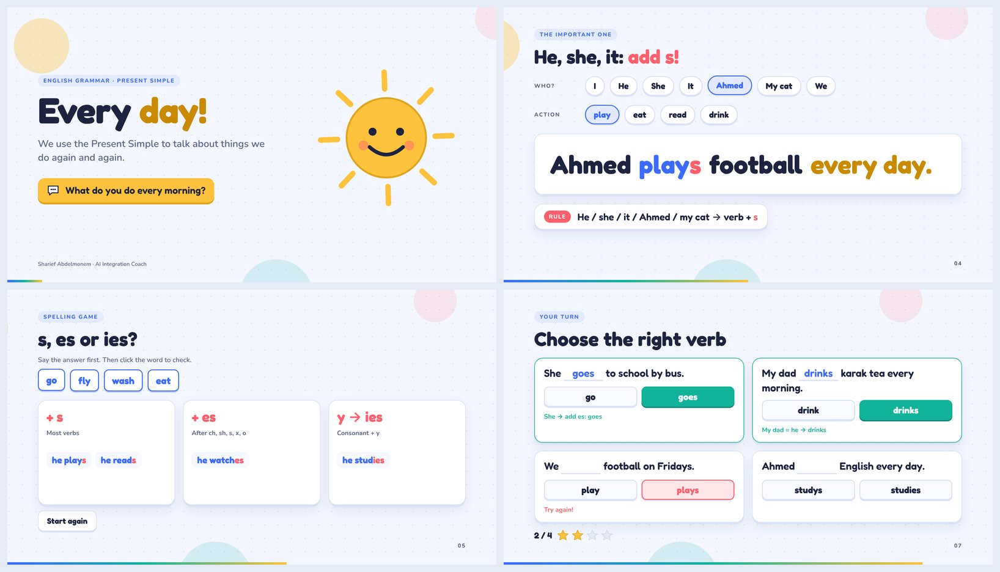
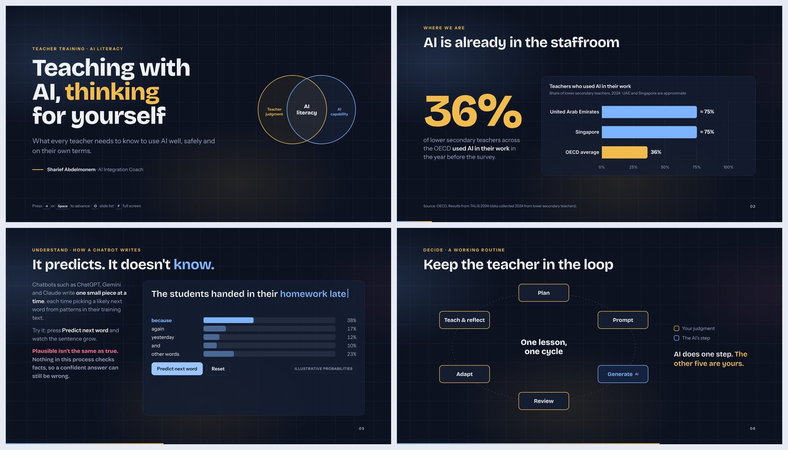

# Interactive HTML Presentation


**▶ Live examples:** https://shariefabdelmonem-netizen.github.io/interactive-html-presentation/

A Claude skill that turns a topic and an audience into an animated, interactive HTML presentation you can run live in a workshop or classroom.

Built by **Sharief Abdelmonem · AI Integration Coach** (#ai_with_sharief).

## What it does

- Asks four questions before building: visual identity, target audience, session duration and number of slides
- Plans the deck around learning outcomes, with an interaction every 3–4 slides
- Uses only sourced data, labels illustrative values, and flags conflicting sources
- Builds one self-contained HTML file: 16:9 stage, GSAP animation, step-by-step reveals, slide transitions
- Presenter controls: arrow keys / Space / clicker, slide list (O), full screen (F), replay (R)
- Respects reduced-motion settings and keyboard-only use
- Can run fully offline when the venue internet is weak
- Tests every slide in a headless browser before delivery

## Install

1. Download `SKILL.md` (or the whole folder).
2. In Claude, go to **Settings → Capabilities → Skills** and upload it, or place the folder in your skills directory for Claude Code.

## Use

Ask Claude something like:

> Make an interactive presentation about the Present Simple for Grade 5 students

or call it by name:

> /interactive-html-presentation AI literacy for teachers, 20 minutes

Claude will ask for anything missing, then build, test and deliver the deck.

## Examples

Both decks run live in your browser. Click a preview to open it.

### Present Simple: Every Day!
Grade 4–6 · A1 · 8 slides · 15 minutes

[](https://shariefabdelmonem-netizen.github.io/interactive-html-presentation/examples/present-simple/)

**[▶ Open the live deck](https://shariefabdelmonem-netizen.github.io/interactive-html-presentation/examples/present-simple/)**

### AI Literacy for Teachers
Teacher training · 12 slides · 20 minutes

[](https://shariefabdelmonem-netizen.github.io/interactive-html-presentation/examples/ai-literacy-for-teachers/)

**[▶ Open the live deck](https://shariefabdelmonem-netizen.github.io/interactive-html-presentation/examples/ai-literacy-for-teachers/)**

Keys inside a deck: `→` / `Space` next · `←` back · `O` slide list · `F` full screen · `R` replay

## Folder structure

```
interactive-html-presentation/
├── SKILL.md        # the skill instructions Claude follows
├── README.md
├── index.html      # landing page for the live examples (GitHub Pages)
├── assets/         # cover and preview images
└── examples/
    ├── present-simple/index.html
    └── ai-literacy-for-teachers/index.html
```
